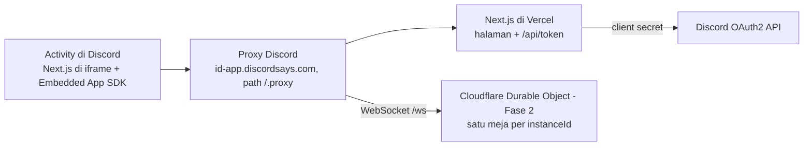

# PRD — UNO Discord Activity

Oct 9, 2026 · @Ibang

## Ringkasan

Kami membangun UNO sebagai Discord Activity dengan Next.js, agar orang di satu voice channel bisa main UNO bersama tanpa keluar dari Discord.

Saat ini sudah ada prototipe satu file HTML: 1 pemain melawan 3 bot, aturan dasar lengkap (Skip, Reverse, +2, Wild, Wild +4), dan sudah diuji lewat 500 simulasi game. PRD ini mengatur cara membawa prototipe itu ke Discord, lalu menambahkan multiplayer.

## Tujuan dan metrik

Tujuan utama: 2–4 orang di satu voice channel bisa memulai dan menyelesaikan satu game UNO dalam waktu kurang dari 10 menit.

**Tujuan**

- Activity bisa dibuka dari tombol Activities di voice channel, di desktop, web, dan mobile.
- Pemain di Activity yang sama otomatis masuk ke meja yang sama.
- Kursi kosong diisi bot, jadi game tetap bisa dimainkan meski hanya 1 orang.

**Bukan tujuan (untuk saat ini)**

- Matchmaking dengan orang asing di luar channel.
- Fitur berbayar, item kosmetik, atau peringkat global.
- Variasi aturan rumah selain yang disebut di bagian Ruang lingkup.

**Metrik keberhasilan**

| Metrik | Target |
| --- | --- |
| Waktu dari membuka Activity sampai kartu pertama dimainkan | < 30 detik |
| Game yang dimulai lalu selesai sampai ada pemenang | ≥ 70% |
| Jeda dari aksi pemain sampai terlihat di layar pemain lain | < 300 ms |
| Game yang macet atau error | < 1% |

## Pengguna dan user stories

Pengguna utama adalah teman-teman yang sedang nongkrong di voice channel Discord dan ingin main game ringan bersama.

| Sebagai | Saya ingin | Supaya |
| --- | --- | --- |
| Pemain | membuka UNO dari menu Activities di voice channel | tidak perlu pindah aplikasi atau membuka link lain |
| Pemain | langsung melihat nama dan avatar Discord teman di meja | tahu sedang melawan siapa |
| Pemain | tetap bisa main walau sendirian | ada bot yang mengisi kursi kosong |
| Pemain | melihat dengan jelas kapan giliran saya dan kartu mana yang bisa dimainkan | game berjalan cepat |
| Pemain yang telat bergabung | menonton game yang sedang berjalan, lalu ikut di game berikutnya | tidak mengganggu game yang sedang jalan |
| Host (yang membuka Activity pertama kali) | memulai game dan memulai ulang setelah selesai | semua siap sebelum kartu dibagikan |
| Pemain di HP | bisa memilih kartu dengan nyaman di layar kecil | bisa main di mana saja |

## Ruang lingkup per fase

Pekerjaan dibagi tiga fase. Setiap fase bisa dirilis dan dipakai sendiri, tanpa menunggu fase berikutnya.

**Fase 1 — UNO lawan bot di Discord**

- Prototipe dipindah ke Next.js (App Router, TypeScript).
- Embedded App SDK: `ready()`, lalu login OAuth2 untuk nama dan avatar.
- Route `/api/token` untuk menukar kode login menjadi access token.
- Game tetap 1 pemain lawan 3 bot, semua berjalan di browser.
- Tampilan responsif untuk desktop dan mobile.

**Fase 2 — Multiplayer dalam satu Activity**

- Server realtime yang menyimpan kondisi game dan memutuskan sah tidaknya setiap langkah.
- Satu meja untuk setiap `instanceId` Activity.
- Lobby sebagai layar pertama: daftar pemain, host menambah/mengurangi bot sendiri (lobby dimulai tanpa bot), host menekan Mulai kalau total pemain 2–10.
- Bisa tersambung lagi tanpa kehilangan kartu kalau koneksi putus; kalau tidak kembali dalam 60 detik, bot mengambil alih.
- Penonton bisa melihat game yang sedang berjalan.

**Fase 3 — Tambahan**

- Tombol UNO beserta penaltinya (ambil 2 kartu kalau ketahuan lupa).
- Opsi aturan rumah: menumpuk +2/+4, menantang Wild +4.
- Animasi kartu dan efek suara.
- Riwayat menang per server Discord.

**Menu sebelum meja (diminta Oct 9, 2026; dikerjakan setelah spike realtime)**

- Layar menu sebelum masuk meja. Isinya belum diputuskan; kandidat: layar judul dengan tombol Main, cara bermain/aturan, pengaturan (kecepatan bot, suara, aturan rumah), pilih mode (lawan bot atau bersama teman di channel).
- Dirancang bersama lobby Fase 2, supaya tidak dirombak saat multiplayer datang.
- Tetap menjaga target < 30 detik dari membuka Activity sampai kartu pertama: mulai main cukup satu ketukan.

## Kebutuhan fungsional

Aturan mengikuti UNO standar 108 kartu. Satu-satunya pengecualian adalah aturan rumah opsional di Fase 3.

**Aturan game**

1. Deck berisi 108 kartu: 4 warna (satu kartu 0, dua kartu untuk 1–9, Skip, Reverse, +2) ditambah 4 Wild dan 4 Wild +4.
2. Setiap pemain dapat 7 kartu. Kartu pembuka harus kartu angka.
3. Kartu boleh dimainkan kalau warna atau angka/simbolnya sama dengan kartu teratas, atau kartu itu Wild.
4. Kalau tidak ada kartu yang bisa dimainkan, pemain ambil 1 kartu. Kartu itu boleh langsung dimainkan kalau cocok; kalau tidak, giliran lewat.
5. Skip melewati pemain berikutnya. Reverse membalik arah giliran. +2 dan +4 membuat pemain berikutnya mengambil kartu sekaligus kehilangan gilirannya.
6. Kalau deck habis, tumpukan buangan (kecuali kartu teratas) dikocok ulang menjadi deck baru.
7. Pemain pertama yang kartunya habis menang.

**Alur dan tampilan**

- Layar loading tampil sampai `ready()` dan login selesai.
- Lobby (Fase 2): avatar pemain, kursi bot, tombol Mulai khusus host.
- Meja: lawan di atas dengan avatar dan jumlah kartunya, deck dan kartu teratas di tengah, warna aktif, dan kartu milik pemain di bawah.
- Kartu yang bisa dimainkan tampil terang; kartu lain diredupkan.
- Saat Wild dimainkan, muncul pilihan 4 warna.
- Ada log singkat aksi terakhir, misalnya "Bot 2 main +2".
- Layar akhir menampilkan pemenang dan tombol Main lagi.

**Bot**

- Mendahulukan kartu berwarna dan menyimpan Wild untuk belakangan.
- Saat memainkan Wild, bot memilih warna yang paling banyak ada di tangannya.
- Jeda sekitar 900 ms per langkah agar pemain bisa mengikuti.

**Login Discord**

- `authorize` dengan scope `identify`, lalu `authenticate` memakai access token dari `/api/token`.
- Nama yang ditampilkan memakai nama global Discord, atau username kalau tidak ada. Nickname server butuh scope `guilds.members.read` dan belum dipakai.

## Kebutuhan non-fungsional

Mulai Fase 2, server menjadi satu-satunya penentu kondisi game. Browser hanya mengirim niat langkah, misalnya "mainkan kartu ke-3".

| Area | Kebutuhan |
| --- | --- |
| Keamanan | Server memeriksa setiap langkah: apakah giliran pemain itu, apakah kartunya ada di tangannya, apakah kartunya boleh dimainkan. |
| Keamanan | Pemain hanya menerima kartunya sendiri; tangan pemain lain dikirim sebagai jumlah kartu saja. |
| Keamanan | Client secret hanya ada di environment variable server, tidak pernah dikirim ke browser. |
| Keamanan | Identitas pemain di server diverifikasi dari access token Discord, bukan dari nama yang dikirim browser. |
| Performa | Ukuran JavaScript halaman pertama < 200 KB setelah gzip. |
| Performa | Aksi pemain terlihat di layar pemain lain dalam < 300 ms. |
| Kompatibilitas | Jalan di Discord desktop, web, Android, dan iOS, dengan lebar layar minimal 360 px. |
| Keandalan | Kondisi meja bertahan selama koneksi pemain terputus dan tersambung lagi; meja dihapus 10 menit setelah kosong. |
| Aksesibilitas | Warna kartu juga ditandai dengan simbol atau teks, bukan hanya warna, supaya pemain buta warna tetap bisa membedakan. |
| Pengujian | Logika aturan game punya test otomatis, termasuk simulasi ratusan game bot yang memastikan jumlah kartu selalu 108 dan setiap game selesai. |

## Arsitektur dan tech stack

Discord membuka halaman Next.js di dalam iframe. Semua request keluar wajib lewat proxy Discord sesuai URL Mappings di Developer Portal.

Server realtime dibuat terpisah dari Vercel, karena fungsi serverless Vercel tidak bisa menahan koneksi WebSocket yang terus terbuka. Server ini didaftarkan di URL Mappings dengan prefix `/ws`; browser tersambung ke `/.proxy/ws/...`.

| Bagian | Pilihan | Catatan |
| --- | --- | --- |
| Frontend | Next.js (App Router) + TypeScript | Komponen game memakai `'use client'`; SDK dijalankan di dalam `useEffect` |
| SDK | `@discord/embedded-app-sdk` | Di-bundle bersama app, karena CDN luar diblokir CSP Discord |
| Logika game | Modul TypeScript murni | Dipakai bersama oleh client (Fase 1) dan server (Fase 2) |
| Auth | OAuth2 lewat SDK + route handler `/api/token` | Membutuhkan `NEXT_PUBLIC_DISCORD_CLIENT_ID` dan `DISCORD_CLIENT_SECRET` |
| Realtime | Cloudflare Workers + Durable Objects (WebSocket hibernation), satu Durable Object per `instanceId`, di akun Cloudflare sendiri | Diputuskan lewat spike M3 (Oct 9, 2026). Paket Workers gratis: 100.000 request/hari, 13.000 GB-detik/hari; lewat batas = ditolak, bukan ditagih |
| Hosting | Vercel untuk Next.js | Domain Vercel diisi di Root Mapping |
| Development | `cloudflared tunnel` ke localhost | Hot reload bisa tidak jalan lewat proxy; refresh manual |
| Test | Vitest | Simulasi game bot dan test aturan |

## Risiko, pertanyaan terbuka, dan milestone

Risiko terbesar ada di Fase 2: WebSocket harus bisa lewat proxy Discord, dan server realtime butuh hosting selain Vercel.

| Risiko | Dampak | Mitigasi |
| --- | --- | --- |
| WebSocket gagal lewat proxy atau URL Mapping | Multiplayer tidak jalan | Terbukti jalan di spike M3: WSS lewat `/.proxy/ws`, dua akun sinkron, ping 27–81 ms |
| CSP Discord memblokir aset atau font dari luar | Tampilan rusak | Semua aset di-bundle atau di-host sendiri; font memakai bawaan sistem |
| Hot reload Next.js tidak jalan lewat tunnel | Development lambat | Kembangkan UI di browser biasa memakai mock SDK, lalu uji di Discord secara berkala |
| Pemain keluar di tengah game | Game macet | Bot mengambil alih setelah 60 detik |
| Biaya hosting server realtime | Biaya bulanan | Paket Workers gratis; Durable Object tidur saat meja diam (hibernation) |
| Activity belum diverifikasi | Hanya pemilik, tim, dan App Testers yang bisa memakai, dan hanya di server < 25 anggota | Tambahkan teman sebagai App Testers; ajukan verifikasi sebelum dibuka untuk umum |

**Pertanyaan terbuka**

- [x] Server realtime: Cloudflare Durable Objects (keputusan spike M3).
- [ ] Apakah Activity juga perlu bisa dimainkan di DM dan text channel, atau cukup di voice channel?
- [x] Maksimal pemain: sampai 10 (diputuskan Oct 9, 2026). Dampak yang harus ditangani di M4: tata letak lawan di HP untuk 9 lawan, aturan kursi bot (sekarang "maksimal 4 kursi"), dan target durasi < 10 menit untuk meja penuh.
- [ ] Aturan rumah mana yang paling diinginkan untuk Fase 3?

**Milestone (berurutan; tanggal menyusul)**

1. **M1 — Game di web:** proyek Next.js, logika game, dan UI meja dikembangkan di browser dengan mock user, lalu bisa dimainkan lewat URL Vercel. Belum menyentuh Discord. — selesai: https://uno-olive-five.vercel.app
2. **M2 — Fase 1 selesai:** app didaftarkan di Discord, `ready()` dan login (nama dan avatar) berjalan, game lawan bot bisa dimainkan di Discord, plus test simulasi lulus. Desain: [spec Fase 1](docs/superpowers/specs/2026-10-09-uno-fase1-ui-design.md). — selesai: diuji di Discord web dan HP.
3. **M3 — Spike realtime:** dua pemain di satu Activity melihat kondisi yang sama lewat WebSocket. — selesai Oct 9, 2026: dua akun di satu voice channel, penghitung sinkron, ping 27–30 ms dan 44–81 ms (perkiraan jeda antar pemain 40–60 ms).
4. **M4 — Fase 2 selesai**, dikerjakan dalam tiga bagian:
   - **Bagian 1, multiplayer dasar:** server Durable Object, lobby, kursi bot, meja sampai 10 pemain, tersambung ulang, bot pengganti setelah 60 detik. Desain: [spec M4 bagian 1](docs/superpowers/specs/2026-10-09-uno-m4-multiplayer-design.md).
   - **Bagian 2, ketahanan:** meja dihapus 10 menit setelah kosong.
   - **Bagian 3, penonton.**
5. **M5 — Fase 3:** tombol UNO, aturan rumah, animasi.
