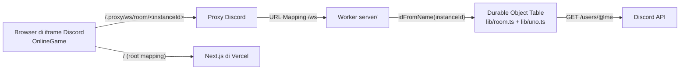

# Desain M4 bagian 1: Multiplayer dasar

Oct 9, 2026 · hasil brainstorming. Sumber kebutuhan: [PRD.md](../../../PRD.md). Bergantung pada Fase 1 ([spec](2026-10-09-uno-fase1-ui-design.md)) dan spike M3 (WebSocket lewat `/.proxy/ws` ke Cloudflare Durable Object terbukti jalan, ping 27–81 ms).

## Tujuan

Teman-teman di satu voice channel bisa membuka Activity, berkumpul di lobby, host memulai, lalu bermain UNO bersama sampai selesai, 2–10 pemain termasuk bot. Server menjadi satu-satunya penentu kondisi game. Pemain yang koneksinya putus kembali ke kursi dan kartunya; kalau tidak kembali dalam 60 detik, bot mengambil alih.

## Pembagian M4

| Bagian | Isi | Status |
| --- | --- | --- |
| **1. Multiplayer dasar** | Server Durable Object, lobby (layar pertama), kursi bot, meja sampai 10 pemain, tersambung ulang, bot pengganti setelah 60 detik | **Spec ini** |
| 2. Ketahanan | Meja dihapus 10 menit setelah kosong | Selesai (Oct 17, 2026, `cc6ef2e`) |
| 3. Penonton | Pemain yang telat bisa menonton game yang sedang berjalan | Selesai (Oct 17, 2026) |

**Bukan bagian 1:** penghapusan meja kosong, penonton, menu Pengaturan, aturan rumah, suara, riwayat menang.

## Keputusan

- Layar pertama di Discord adalah **lobby** (tidak ada layar judul).
- **Kursi bot diatur host sepenuhnya.** Lobby dimulai tanpa bot; host menambah/mengurangi dengan **+ Bot** / **− Bot**. Mulai aktif kalau total pemain (manusia + bot) 2–10.
- **Host** = manusia pertama yang masuk meja. Kalau koneksi host putus selama 60 detik (termasuk karena tab ditutup), host pindah ke manusia berikutnya yang tersambung, menurut urutan masuk. Host yang kembali tidak otomatis menjadi host lagi.
- Meja di HP: **lawan duduk melingkar** di busur di atas meja (pilihan C saat brainstorming). Nama hanya tampil untuk yang sedang giliran; semua kursi punya `aria-label` lengkap.
- **Main lagi** (host) mengembalikan semua orang ke lobby dengan susunan bot yang sama; pemain yang menunggu ikut masuk.
- **Di luar Discord** (browser biasa): tetap mode Fase 1, langsung lawan 3 bot di browser, tanpa lobby dan tanpa server. Pengecualian untuk development: kalau `NEXT_PUBLIC_WS_URL` diisi, browser biasa memakai mode online dengan token dev (lihat Deploy).
- Server: **Cloudflare Worker + Durable Object langsung** (tanpa PartyKit/PartyServer), di folder `server/` repo yang sama, mengimpor `lib/` langsung.

## Alur dan layar

**Membuka Activity di Discord:** loading + login (Fase 1) → tersambung ke meja milik `instanceId` → layar sesuai fase meja.

**Lobby:**
- Daftar kursi berurutan: avatar, nama Discord, tanda **Host**; bot tampil sebagai "Bot 1", "Bot 2", …
- Host melihat **+ Bot**, **− Bot** (hanya kalau ada bot), **Mulai** (aktif kalau total 2–10). Pemain lain melihat "Menunggu host memulai…".
- Tombol **Cara bermain** membuka dialog ringkasan aturan (pola `<dialog>` seperti pemilih warna).
- Kalau meja penuh (10 kursi), orang berikutnya masuk antrean dan melihat "Meja penuh, kamu masuk antrean".

**Game berjalan:** meja (komponen `Table` Fase 1) dengan lawan melingkar. Orang yang membuka Activity di tengah game melihat "Game sedang berjalan" + daftar pemain, lalu otomatis masuk lobby berikutnya.

**Game selesai:** layar pemenang. Host melihat **Main lagi**; pemain lain melihat "Menunggu host…".

**Koneksi putus:**
- Kursi dan kartu tetap di server. Tersambung lagi → kembali ke kursi dengan kartu yang sama.
- Tidak kembali dalam **60 detik** → kursi ditandai `botControlled`; bot memainkan gilirannya. Kalau pemilik kembali, kursi dikembalikan.
- Dua tab dari akun yang sama: koneksi terbaru menggantikan yang lama (yang lama ditutup dengan kode 4002).

## Arsitektur



### File

| File | Tanggung jawab |
| --- | --- |
| `lib/uno.ts` | Aturan game (Fase 1), dipakai apa adanya. Nomor versi dipegang `lib/room.ts`, bukan di sini. |
| `lib/room.ts` (baru) | Logika meja murni: kursi, host, bot, antrean, fase, versi, takeover, pembuatan snapshot per penerima, validasi pesan dari browser |
| `lib/seat-layout.ts` (baru) | Posisi lawan di busur untuk 1–9 lawan |
| `server/worker.ts` (baru) | Routing `/room/<id>` dan `/ws/room/<id>` ke Durable Object; class `Table` (Durable Object) yang memegang WebSocket, storage, timer bot, alarm takeover, verifikasi token |
| `server/wrangler.jsonc` (baru) | Konfigurasi Worker + binding Durable Object (`new_sqlite_classes`) |
| `components/OnlineGame.tsx` (baru) | WebSocket, reconnect, memilih layar per fase |
| `components/Lobby.tsx` (+ `.module.css`) (baru) | Layar lobby |
| `components/Table.tsx` | Dipakai kedua mode; lawan melingkar, tanda putus/bot |
| `components/DiscordGate.tsx` | Meneruskan `accessToken` dan `instanceId`; memilih `OnlineGame` (Discord) atau `Game` (browser) |

### `lib/room.ts`

```ts
type Seat = {
  id: string;            // user id Discord, atau 'bot-<n>'
  name: string;
  avatarUrl: string | null;
  bot: boolean;
  connected: boolean;     // selalu true untuk bot
  disconnectedAt: number | null;
  botControlled: boolean; // manusia yang kursinya sedang dijalankan bot
};

type Room = {
  phase: 'lobby' | 'playing' | 'ended';
  seats: Seat[];          // urutan kursi = urutan giliran, maks 10
  queue: Seat[];          // manusia yang menunggu (meja penuh atau game berjalan)
  hostId: string | null;
  game: GameState | null; // dari lib/uno.ts, ada saat playing/ended
  v: number;              // naik setiap perubahan
};
```

Fungsi murni (semua mengembalikan `Room` baru; perintah tidak sah mengembalikan objek yang sama):

- `newRoom(): Room`
- `join(room, user, now)`: manusia masuk. Kalau sudah punya kursi → `connected = true`, `botControlled = false`. Kalau lobby dan kursi < 10 → kursi baru. Selain itu → antrean. Host diisi kalau kosong.
- `leave(room, userId, now)`: koneksi ditutup → `connected = false`, `disconnectedAt = now`. Di lobby, kursi manusia yang putus dihapus setelah 60 detik lewat `expire`.
- `expire(room, now)`: dipanggil alarm. Kursi yang putus ≥ 60 detik: di lobby dihapus; saat playing → `botControlled = true`. Host dipindah kalau host termasuk.
- `command(room, userId, msg)`: `addBot`, `removeBot`, `start` (hanya host, hanya lobby, total 2–10 → `newGame(names)` dari `lib/uno.ts`), `restart` (hanya host, hanya ended → lobby, antrean masuk ke kursi kosong), `play`/`draw`/`pass` (kursi diambil dari `userId`, `msg.v` harus sama dengan `room.v`, lalu `apply` dari `lib/uno.ts`; `phase` jadi `ended` kalau ada pemenang).
- `botTurn(room)`: kalau kursi giliran adalah bot atau `botControlled` → `apply(botAction(...))`.
- `snapshot(room, userId)`: pesan `room` untuk satu penerima, berisi `viewFor(game, kursiPenerima)` kalau dia duduk.
- `parseClientMessage(raw: unknown)`: type guard; mengembalikan pesan yang sah atau `null`.

### Protokol

Browser → server (JSON):

| Pesan | Siapa | Catatan |
| --- | --- | --- |
| `{ type: 'hello', token }` | semua | Wajib pertama. Server memanggil `GET https://discord.com/api/users/@me` dengan `Authorization: Bearer <token>`; gagal → tutup 4001 |
| `{ type: 'addBot' }`, `{ type: 'removeBot' }`, `{ type: 'start' }` | host, lobby | |
| `{ type: 'restart' }` | host, ended | Kembali ke lobby |
| `{ type: 'play', index, color?, v }`, `{ type: 'draw', v }`, `{ type: 'pass', v }` | pemain di kursinya, playing | Nomor kursi tidak dikirim |

Server → browser, satu jenis:

```ts
type RoomMessage = {
  type: 'room';
  phase: 'lobby' | 'playing' | 'ended';
  v: number;
  you: string;                 // user id penerima
  hostId: string | null;
  seats: { id: string; name: string; avatarUrl: string | null; bot: boolean; connected: boolean; botControlled: boolean }[];
  queue: { id: string; name: string }[];
  view: PlayerView | null;     // viewFor untuk kursi penerima; null kalau tidak duduk
  winner: number | null;
};
```

Dikirim ke setiap koneksi setelah setiap perubahan, masing-masing dengan `view` miliknya. Kode tutup: 4001 token tidak valid, 4002 digantikan tab lain, 4003 `instanceId` tidak sah.

### Durable Object `Table`

- `fetch`: terima WebSocket (`ctx.acceptWebSocket`, hibernation), belum masuk meja sampai `hello` diverifikasi. User id disimpan dengan `ws.serializeAttachment`.
- Kondisi `Room` dibaca dari storage saat bangun dan ditulis setiap berubah (`ctx.storage.put('room', room)`), karena memori hilang saat hibernation.
- Setelah setiap perubahan: kirim snapshot ke semua; kalau giliran bot → `setTimeout(900 ms)` → `botTurn`; kalau ada kursi putus → `ctx.storage.setAlarm(disconnectedAt + 60 s)`; `alarm()` memanggil `expire`.
- `instanceId` harus cocok `^[\w-]{1,100}$`, selain itu tutup 4003.
- Worker meneruskan `/room/<id>` dan `/ws/room/<id>` (jaga-jaga apakah proxy membuang prefix).

## Tampilan

- **Lawan melingkar:** `seatLayout(n, width, height)` mengembalikan posisi `{x, y}` untuk n = 1–9 di busur setengah elips di atas meja, sudut dibagi rata dari kiri ke kanan mengikuti urutan giliran. Desktop memakai busur lebih lebar.
- **Kursi lawan:** avatar 30 px dengan badge jumlah kartu; garis tepi `--accent` saat giliran; nama (11 px) hanya untuk yang giliran. Putus → redup + ⟳; dijalankan bot → 🤖. `role="img"`, `aria-label` lengkap ("Rina, 3 kartu, sedang giliran, koneksi putus").
- **Lobby:** felt yang sama, daftar kursi vertikal (avatar 36 px, nama, tanda Host/Bot), tombol host di bawah, tombol Cara bermain kecil di atas. Token, kontras, ukuran teks minimum 11 px, dan `prefers-reduced-motion` mengikuti spec Fase 1.
- **Pita koneksi:** "Menyambung ulang…" di atas meja saat WebSocket putus; kartu tidak bisa dimainkan.

## Penanganan error

| Kejadian | Hasil untuk pemain |
| --- | --- |
| Token tidak valid/kedaluwarsa | Tutup 4001 → "Gagal masuk ke meja" + Coba lagi (login ulang) |
| Server tidak terjangkau | Pita "Menyambung ulang…", coba lagi setelah 1, 2, 4, 8 detik; setelah ~30 detik gagal → tombol Coba lagi |
| Aksi ditolak (bukan giliran, versi lama, kartu tidak sah, bukan host) | Diabaikan; snapshot berikutnya mengembalikan tampilan yang benar |
| Meja penuh | "Meja penuh, kamu masuk antrean" sampai ada kursi saat kembali ke lobby |
| Semua manusia keluar saat main | Bot mengambil alih setelah 60 detik |
| Kuota gratis Cloudflare habis | Tampil seperti server tidak terjangkau; reset 00:00 UTC |

## Pengujian

- **`lib/room.ts` (Vitest):** join/leave/expire, host pindah, addBot/removeBot dalam batas 2–10, start, aksi dengan `v` lama ditolak, kursi diambil dari identitas (bukan dari pesan), takeover 60 detik dan pengembalian, orang ke-11 ke antrean, restart memasukkan antrean, `snapshot` tidak pernah berisi tangan lawan, `parseClientMessage` menolak bentuk yang salah.
- **Simulasi:** game 2–10 pemain (semua bot) selalu selesai dan total kartu 108 di setiap langkah.
- **`lib/seat-layout.ts`:** posisi 1–9 lawan simetris kiri-kanan dan tidak bertumpuk.
- **Server:** tes integrasi dengan `@cloudflare/vitest-plugin` (Durable Object sungguhan lokal; `@cloudflare/vitest-pool-workers` sudah deprecated dan hanya mendukung Vitest 4, sedangkan `@cloudflare/vitest-plugin` 1.4 mendukung Vitest 5; konfigurasi: `cloudflareTest({ wrangler: { configPath } })` di `vitest.config.ts`, `env`/`exports` dari `cloudflare:workers`, tipe dari `@cloudflare/vitest-plugin/types`): hello dengan token palsu ditutup 4001, token dev ditolak kalau `DEV_TOKENS` tidak diisi, dua klien melihat kondisi yang sama, tangan lawan tidak terkirim, klien yang tersambung ulang mendapat kartunya kembali. Discord API di-mock di batas `fetch`.
- **UI:** probe Chrome headless (lobby dengan mock server lokal `wrangler dev`, meja 10 pemain di 360 px tanpa scroll samping) dan uji manual dua akun di Discord.

## Deploy

- `wrangler deploy` dari `server/` ke akun Cloudflare pemilik (paket gratis), menggantikan worker spike `uno-spike-realtime`.
- Discord URL Mapping: `/ws` → domain worker baru; root `/` → `uno-olive-five.vercel.app`.
- Next.js tetap di-deploy ke Vercel.
- **Development lokal mode online:** `wrangler dev` di `server/` dengan variabel `DEV_TOKENS=1` (hanya di `.dev.vars`, tidak pernah di produksi), dan Next.js dengan `NEXT_PUBLIC_WS_URL=ws://localhost:8787`. Browser biasa lalu memakai mode online dengan token `dev:<id>:<nama>`; server hanya menerima token berbentuk ini kalau `DEV_TOKENS=1`. Ini juga dipakai probe Chrome headless dan tes integrasi. Produksi tidak pernah menerima token dev (dites).
